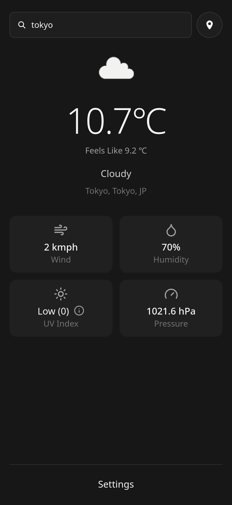
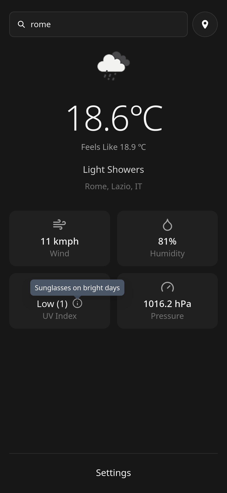

# Vaercast

A weather app built while learning React. Search any place in the world, or use your current location, and see its current conditions: temperature, wind, humidity, UV index, and pressure. Powered by Open-Meteo.

**Live demo:** https://vaercast.vercel.app/

<p>
  
  
</p>

## Stack

- **React + TypeScript** (Vite)
- **SWR** for data fetching, caching, and revalidation
- **Tailwind CSS** for styling
- **Open-Meteo** as the weather API (no key required)
- **react-icons** (Lucide set) for icons

## Features

- City search with a debounced input, so a request only fires after you stop typing
- No request is sent when the search box is empty (SWR key is `null`)
- Current conditions for the searched city or the user’s current location: temperature, weather description, and icon
- Detail cards for wind (speed), humidity, UV index, and pressure
- UV index shown with its WHO category (for example, "Moderate (5)") and an info tooltip with burn time and protection advice
- Accessible, button-based tooltip that works by tap on mobile and by click on desktop
- Loading and error states handled by SWR, with caching by city
- Fully typed API response shape end to end (fetcher → SWR generic → JSX)
- Mobile-first layout with a soft, muted dark theme

## Planned

- Full unit conversion (temperature, wind speed, pressure), currently only partly functional
- Upcoming days forecast
- Picker for cities with the same name (for example, Paris, France vs. Paris, Texas)
- Day and night themes based on local sunset time
- Zustand for shared state

## Getting started

```bash
git clone https://github.com/turbolagged/Vaercast
cd Vaercast
npm install
npm run dev
```
