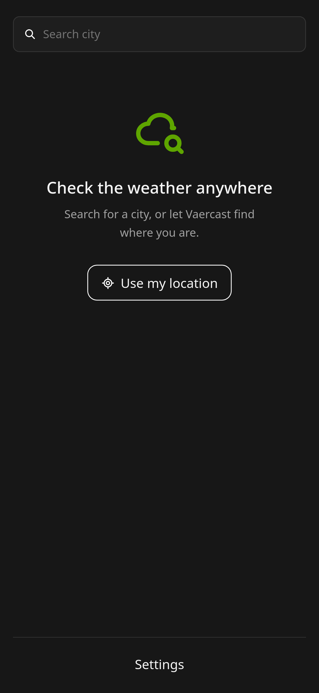
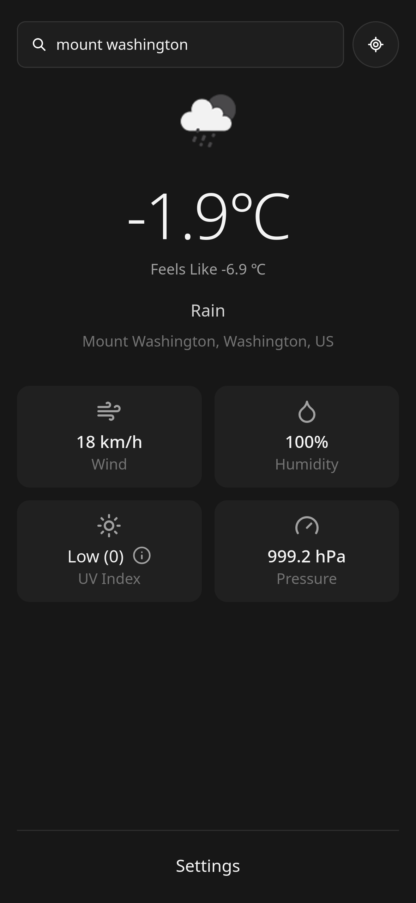
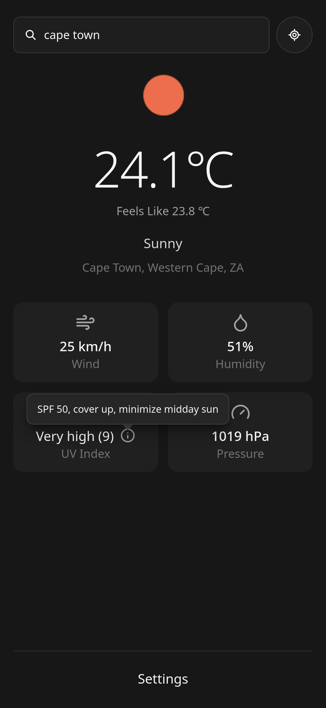
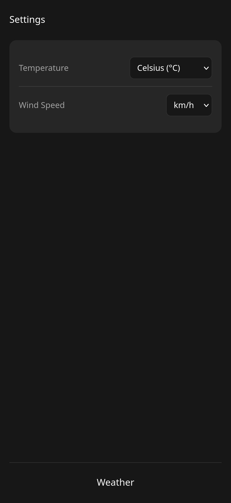

# Vaercast

A mobile-first weather web app built while learning React. Search any place in the world, or use your current location, and see its current conditions: temperature, wind, humidity, UV index, and pressure. Powered by [Open-Meteo](https://open-meteo.com/).

**Live demo:** https://vaercast.vercel.app/

<p>
   &nbsp;
   &nbsp;
   &nbsp;
  
</p>

## Stack

- **React + TypeScript** (Vite)
- **SWR** for data fetching, caching, and revalidation
- **Tailwind CSS** for styling
- **Open-Meteo** as the weather API (no key required)
- **react-icons** (Lucide set) for icons

## Features

- Mobile-first layout with a soft, muted dark theme
- Friendly empty state with a "Use my location" shortcut
- City search with a debounced input, so a request only fires after you stop typing, and none is sent while the search box is empty
- Current conditions for a searched city or your current location: temperature, weather description, and icon
- Location label with a timezone fallback when no place name is available
- Detail cards with icons for wind speed, humidity, UV index, and pressure
- UV index shown with its WHO category (for example, "Moderate (5)") and an info popover with burn time and protection advice
- Accessible, button-based popover that works by tap on mobile and click on desktop
- Settings screen to switch temperature and wind speed units
- Note: opening Settings and returning home clears the current search

## Planned

- Complete unit conversion for temperature, wind speed, and pressure (currently only partly functional)
- Multi-day forecast
- City picker for places with the same name (for example, Paris, France vs. Paris, Texas)
- Day and night themes based on the local sunrise and sunset times
- Shared state with Zustand, so the current search survives a visit to Settings

## Getting started

```bash
git clone https://github.com/turbolagged/Vaercast
cd Vaercast
npm install
npm run dev
```
